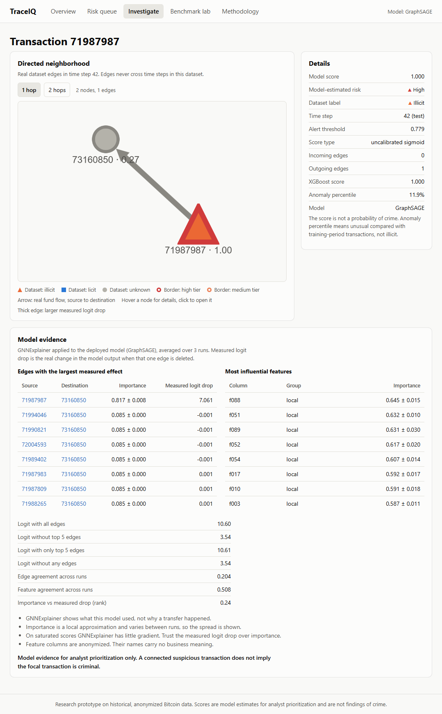

# TraceIQ

**Intelligent Financial Fraud Detection Using Temporal Graph Neural Networks**

TraceIQ classifies Bitcoin transactions in the Elliptic transaction graph as likely illicit or licit, using transaction features, directed money-flow neighborhoods, and sequential (temporal) modeling across time steps. It exposes the results through a fully local FastAPI service and a React investigation dashboard with explainable-AI evidence.

> **Status:** complete. All stages are built, and 81 automated tests pass. Every number below comes from the saved artifacts.

## Quick start (Windows, already built)

```powershell
.\.venv\Scripts\python.exe -m uvicorn src.api.main:app --port 8000
```

Open http://127.0.0.1:8000 for the dashboard. See [Section 5](#5-environment-setup-windows-11--wsl2) to build from scratch.

## Key results

Test period: steps 40-49, 11,184 known transactions, 636 illicit. Each neural model trained for exactly 20 epochs (`gnn.epochs` in `config/experiments.yaml`). Tree and linear models do not train in epochs. This fixed budget is a deliberate change from the guide's early stopping, so that models can be compared epoch by epoch.

| Model | Features | Edges | Accuracy | Precision | Recall | F1 | PR-AUC |
|---|---|---|---:|---:|---:|---:|---:|
| **XGBoost** | all | none | 0.971 | 0.855 | 0.592 | 0.699 | **0.675 ± 0.003** |
| Random Forest | all | none | 0.973 | 0.922 | 0.576 | 0.709 | 0.661 ± 0.001 |
| GraphSAGE | local | symmetrized | 0.966 | 0.801 | 0.548 | 0.649 | 0.627 ± 0.007 |
| MLP (no edges) | local | none | 0.965 | 0.779 | 0.543 | 0.636 | 0.566 ± 0.011 |
| Static GCN | local | symmetrized | 0.936 | 0.456 | 0.547 | 0.496 | 0.511 ± 0.054 |
| EvolveGCN-O | local | symmetrized | 0.933 | 0.461 | 0.538 | 0.486 | 0.465 ± 0.072 |
| EvolveGCN-H | all | symmetrized | 0.933 | 0.449 | 0.458 | 0.446 | 0.459 ± 0.068 |
| Logistic Regression | all | none | 0.843 | 0.203 | 0.604 | 0.304 | 0.266 ± 0.000 |

- **Accuracy:** always guessing licit scores 0.943 here, because only 5.7% of test transactions are illicit. Static GCN, both EvolveGCN models and Logistic Regression fall below that, so read accuracy alongside F1 and PR-AUC.
- **RQ1, graphs:** edges clearly help a neural model (GraphSAGE beats the MLP by 0.061), but tree ensembles stay ahead of every graph model.
- **RQ2, temporal state:** within 20 epochs it does not help (EvolveGCN-O trails Static GCN by 0.046). With up to 150 epochs and early stopping it led by 0.050, so this result reflects the short budget: EvolveGCN gets 6 weight updates per epoch against 30 for static models.
- **Step 43:** the best models collapse from about 0.87 PR-AUC to about 0.05, and no model holds up. Temporal state gives no protection.
- **RQ3, explanations:** the dashboard shows real evidence, but GNNExplainer importance agrees only weakly with measured edge effects (median rank correlation 0.30), so edges are ranked by measured effect.

The full analysis is in [docs/report.md](docs/report.md). Decisions are in [docs/design_note.md](docs/design_note.md), and data findings are in [docs/eda_summary.md](docs/eda_summary.md).



Source of truth for all design decisions: `TraceIQ_Complete_Project_Guide_WSL.pdf` (in this folder). Where this README and the PDF disagree, the PDF wins.

---

## Table of contents

1. [What this project is](#1-what-this-project-is)
2. [Research questions and success criteria](#2-research-questions-and-success-criteria)
3. [Dataset](#3-dataset)
4. [Key concepts](#4-key-concepts-read-before-coding)
5. [Environment setup (Windows 11 + WSL2)](#5-environment-setup-windows-11--wsl2)
6. [Repository layout](#6-repository-layout)
7. [Pipeline overview](#7-pipeline-overview)
8. [Stage-by-stage build plan (A to K)](#8-stage-by-stage-build-plan-a-to-k)
9. [Models](#9-models)
10. [Chronological split and leakage rules](#10-chronological-split-and-leakage-rules)
11. [Loss, scores and thresholds](#11-loss-scores-and-thresholds)
12. [Evaluation protocol](#12-evaluation-protocol)
13. [Explainability and anomaly signals](#13-explainability-and-anomaly-signals)
14. [Backend API](#14-backend-api)
15. [Dashboard](#15-dashboard)
16. [Testing](#16-testing)
17. [Reproducibility](#17-reproducibility)
18. [Performance and troubleshooting](#18-performance-and-troubleshooting)
19. [Deliverables: report, demo, portfolio](#19-deliverables-report-demo-portfolio)
20. [Honesty rules](#20-honesty-rules-what-we-will-and-will-not-claim)
21. [Ethics, licensing, attribution](#21-ethics-licensing-attribution)
22. [Commands cheat sheet](#22-commands-cheat-sheet-target-interface)
23. [References](#23-references)

---

## 1. What this project is

**Problem.** Traditional fraud detection scores each transaction on its own. It misses hidden connections, coordinated networks and patterns that change over time, which causes both missed fraud and false alerts.

**Approach.** Model transactions as a directed graph and compare three levels of context under identical conditions:

| Level | Model | Sees |
|---|---|---|
| 1 | Logistic Regression / XGBoost | Own features only |
| 2 | GraphSAGE (static GNN) | Own features + directed neighbors |
| 3 | EvolveGCN or custom recurrent graph model (temporal) | Neighbors + parameter state carried across ordered time steps |

**Output.** Per-transaction model risk scores, benchmark metrics, error analysis, per-transaction explanations, and a local dashboard to investigate flagged transactions.

**What it is not.** A research prototype for analyst triage on Bitcoin data. It is not a production banking product, not credit-card or retail fraud detection, and never an automatic accuser.

---

## 2. Research questions and success criteria

**Research questions**

- **RQ1.** Do graph-based models outperform tabular baselines under the same chronological holdout?
- **RQ2.** Does sequential modeling across time steps improve out-of-time illicit detection?
- **RQ3.** Can a readable interface show the subgraph and feature evidence behind a flagged prediction?

**Hypothesis.** Relational and temporal context adds predictive signal, but the size of the gain must be measured, not assumed. "No improvement" is a valid, reportable result.

**Success criteria (project is done when all hold)**

- [x] Scripted, reproducible data loader with documented class mapping, node mapping and chronological split.
- [x] At least one tabular baseline, one static GNN and one sequential temporal model, evaluated on the same held-out time steps.
- [x] Minority-class metrics (precision, recall, F1, PR-AUC), confusion matrix and a documented decision threshold.
- [x] Local dashboard that loads real saved predictions and shows a real directed transaction neighborhood.
- [x] Explanations phrased as model evidence, with limitations stated.
- [x] Academic report and this README sufficient for another student to reproduce everything.

**Minimum viable research contribution:** a leakage-safe chronological benchmark of (XGBoost or Logistic Regression) vs GraphSAGE vs EvolveGCN, plus error analysis and an interactive explanation of selected transactions.

---

## 3. Dataset

**Primary dataset: Elliptic Bitcoin transaction dataset** (Weber et al., 2019).

| Property | Value |
|---|---|
| Nodes | 203,769 transactions |
| Edges | 234,355 directed edges (fund flow) |
| Features | 166 (first 94 local incl. time step, remaining 72 aggregated neighborhood) |
| Time steps | 49, about two weeks apart |
| Labels | 4,545 illicit, 42,019 licit, 157,205 unknown |
| Cross-step edges | **None.** Each step is a separate subgraph. |

**Files** (in `data/raw/`, tracked with Git LFS):

| File | Content |
|---|---|
| `elliptic_txs_features.csv` | txId, time step, 165 unnamed numeric features. Headerless, so inspect before assuming. |
| `elliptic_txs_classes.csv` | txId, class: `1` = illicit, `2` = licit, `unknown` |
| `elliptic_txs_edgelist.csv` | source txId, destination txId. Preserve direction. |

**Download**

1. Kaggle: https://www.kaggle.com/ellipticco/elliptic-data-set (requires a free Kaggle account; accept the terms).
2. Either download the zip manually into `data/raw/`, or use the Kaggle CLI inside WSL:
   ```bash
   pip install kaggle
   # place API token at ~/.kaggle/kaggle.json (chmod 600)
   kaggle datasets download -d ellipticco/elliptic-data-set -p data/raw --unzip
   ```
3. Run `python -m src.data.verify_download` to write the checksum manifest.

**License:** CC BY-NC-ND 4.0. The three files are included here **unmodified** (verbatim, SHA-256 identical to the official Kaggle release) for non-commercial academic use, with attribution to Elliptic / Weber et al. (2019). They are not altered or adapted; all processed outputs go to `data/processed/`. For commercial use, obtain the data from the original source. Official download: `import kagglehub; kagglehub.dataset_download("ellipticco/elliptic-data-set")` (no login needed).

**Not used in the core project:** Elliptic++ (adds actor/address data, much more complexity). Optional future work only.

**Dataset truths we must respect**

- A node is one **transaction**, not an account or person.
- `unknown` is **not** legitimate. It is excluded from supervised loss and from all metrics.
- Features are anonymized. We never invent business meanings for column names, and the dashboard never shows senders, cities, IPs or balances.
- Edges are never created between time steps.

---

## 4. Key concepts (read before coding)

- **Class encoding:** licit = 0, illicit = 1, unknown = separate mask (never 0).
- **Feature / label / prediction / risk score** are four different things (Guide Section 2.2).
- **Why not accuracy:** a model predicting "licit" for everything scores high accuracy on rare-fraud data. Always report illicit-class precision, recall, F1, PR-AUC, and alert volume.
- **Worked example:** 100 labeled, 10 illicit. Model flags 12, 8 correct: TP=8, FP=4, FN=2, TN=86. Precision 66.7%, recall 80%, F1 about 72.7%, accuracy 94%.
- **Directed graph:** `u -> v` is not `v -> u`. Incoming and outgoing neighbors are different things.
- **K-hop / message passing:** a 2-layer GNN uses 2-hop context.
- **Temporal leakage:** using information unavailable at prediction time (fitting a scaler on all 49 steps, tuning on test steps, leaking test labels).
- **Temporal claims allowed:** "snapshots trained in order and parameters evolved". **Not allowed:** tracking the same customer across steps, real-time ring detection, or any gain not measured.

Full theory lives in the PDF, Sections 01 to 04.

---

## 5. Environment setup (Windows 11 + WSL2)

> **This repository was built and run natively on Windows 11**, because WSL was not installed on the build machine: Python 3.11, PyTorch 2.11 with CUDA 12.8, PyG 2.8, on an RTX 5060 Laptop GPU with 8 GB. Nothing is Linux-specific, so the WSL steps below also apply but were not run.
>
> Native Windows setup:
> ```powershell
> py -3.11 -m venv .venv
> .\.venv\Scripts\python.exe -m pip install -r requirements.txt
> .\.venv\Scripts\python.exe -m pytest -q
> ```
> For the dashboard, Node 24 and `cd frontend; npm install; npm run build`.

Target hardware: Windows 11, Ryzen 9 HX, 24 GB RAM, NVIDIA RTX 5070 8 GB VRAM. Everything runs locally. No cloud notebooks or hosted endpoints.

**5.1 Install WSL2** (PowerShell as Administrator)
```powershell
wsl --install
wsl --update
wsl --list --verbose     # distro must show VERSION 2
```
Reboot if asked, then finish Ubuntu first-run user setup.

**5.2 GPU driver rule.** Install the NVIDIA **Windows** driver with WSL CUDA support. Do **not** install a Linux display driver inside Ubuntu.

**5.3 Ubuntu base** (inside WSL)
```bash
sudo apt update && sudo apt upgrade -y
sudo apt install -y python3 python3-venv python3-pip git build-essential curl
mkdir -p ~/projects/traceiq && cd ~/projects/traceiq
python3 -m venv .venv
source .venv/bin/activate
python -m pip install --upgrade pip setuptools wheel
```
Keep the active project under `~/projects/traceiq`, **not** `/mnt/c` or `/mnt/e`, for much faster file I/O. (This Windows folder `E:\TraceIQ` holds the planning material; copy or clone into WSL to work.)

**5.4 PyTorch.** Open https://pytorch.org/get-started/locally/, choose Linux / Pip / CUDA build matching your driver, and paste the generated command. Then verify:
```bash
python -c "import torch; print(torch.__version__, torch.cuda.is_available())"
python -c "import torch; print(torch.cuda.get_device_name(0))"
nvidia-smi
```
The RTX 5070 (Blackwell) needs a recent CUDA 12.8+ PyTorch build. If `is_available()` is False, fall back to CPU and keep going.

**5.5 Graph and app libraries**
```bash
python -m pip install torch_geometric pandas numpy scikit-learn xgboost \
    matplotlib seaborn networkx pyyaml tqdm pytest \
    fastapi uvicorn pydantic joblib
```
Install PyTorch Geometric Temporal **only after** the static GNN works, and only if it matches your torch/PyG versions. Fallback (valid): implement a recurrent snapshot model with PyG + a PyTorch GRU and name it honestly as a "custom recurrent graph model", not EvolveGCN.

**5.6 Frontend tools:** Node.js LTS in WSL (`nvm install --lts`).

**Stop/Go checkpoint:** venv activates, `import torch` and `import torch_geometric` succeed, a tiny CUDA tensor op works. If the GPU fails, build the CPU data pipeline first. Do not block on the GPU.

---

## 6. Repository layout

```
traceiq/
  README.md                  this file
  requirements.txt           pinned dependencies
  .gitignore                 data, venv, checkpoints, caches, secrets
  config/experiments.yaml    split steps, model and training settings, seeds
  data/raw/                  downloaded source, tracked via Git LFS, kept unmodified
  data/processed/            indexed snapshots, masks, scaler
  notebooks/                 optional EDA (logic must live in src/)
  src/data/                  load, validate, split, graph builder
  src/features/              preprocessing and normalization
  src/models/                baseline, graphsage, temporal
  src/train/                 training loops and checkpoints
  src/eval/                  metrics, plots, error analysis
  src/explain/               subgraph and feature explanations
  src/api/                   FastAPI local service
  frontend/                  React investigation dashboard
  artifacts/                 weights, predictions, metrics JSON, reports
  tests/                     data, split, model, evaluator, API tests
  docs/                      design note, EDA summary, report, screenshots
```

Rule: training, inference and frontend logic never live in one notebook. Notebooks explain; scripts do the work.

---

## 7. Pipeline overview

```
Data ingestion + validation   CSV -> canonical IDs, masks, snapshots
        |
Offline training + evaluation baseline -> GraphSAGE -> temporal model
        |
Artifact generation           weights, scores, neighborhoods, metrics JSON
        |
FastAPI local service         risk queries, neighbors, explanations, metrics
        |
React dashboard               queue, graph explorer, details, benchmark lab
```

| Layer | Input | Output |
|---|---|---|
| Data ingest | Original CSVs | Validated tables + ID map |
| Graph builder | Tables + time step | PyG `Data` snapshots + masks |
| Trainer | Snapshots + config | Weights, scaler, run metadata |
| Evaluator | Held-out labels + scores | Metrics, thresholds, error analysis |
| Serving | Saved model/predictions | JSON transaction + neighborhood records |
| Frontend | API responses | Risk explorer, graph, explanations |

Training is offline; the dashboard serves frozen artifacts. No retraining per web request.

---

## 8. Stage-by-stage build plan (A to K)

Dependency order, not a calendar. **Do not start a stage until the previous gate passes.** Never build the dashboard first and hunt for a model afterwards.

### A. Research specification
- **Do:** freeze dataset, target (illicit = positive), success metrics, evaluation protocol.
- **Gate:** two-page design note (`docs/design_note.md`) with approved data definitions.

### B. Local toolchain
- **Do:** WSL2, venv, PyTorch, PyG, GPU or CPU fallback (Section 5).
- **Gate:** tensor op works and PyG imports.

### C. Dataset integrity
- **Do:** load the 3 files, build `original_tx_id -> node_index` map (and reverse), apply to both edge columns, run quality report:
  - row/column counts, duplicate IDs, missing and non-finite values
  - every edge endpoint exists in the node map (no silent drops)
  - label distribution overall and per time step
  - edge direction, self-links, repeated links, same-time-step check of endpoints
  - feature distributions and outliers
  - write `artifacts/data_manifest.json` (source URL, license, file hashes, schema checks)
- **Gate:** validated canonical tables + manifest. Can load any one time step, print node count, directed-edge count, class balance, and draw a small labeled network.

### D. Chronological experiment design
- **Do:** inspect known-label counts per time range first, then **predeclare** the split in `config/experiments.yaml`. Illustrative starting point: train steps 1-30, validation 31-39, test 40-49. If late steps have too few known illicit nodes, adjust the scheme **without looking at test performance** and document why. Fit imputer and scaler on training rows only; save train/val/test masks and the fitted processor.
- **Gate:** saved deterministic masks and feature processor; split tests pass.

### E. EDA (research stage, before model selection)
Figures to generate (`artifacts/figures/`):
- licit/illicit/unknown counts and percentages
- illicit-to-licit ratio in train/val/test
- transactions and known-illicit per time step (49 bars)
- in/out-degree distributions, isolated nodes, connected components
- missing-value rates, selected feature distributions
- two small sampled neighborhoods with direction and known labels
- distribution-shift check across time

Write `docs/eda_summary.md` answering: what is one record, what % is labeled, how positives vary over time, how sparse is the graph, does it fit full-batch on 8 GB, what limitations bias conclusions.

### F. Tabular baseline
- **Do:** Logistic Regression and XGBoost on labeled training rows only; class weighting if recall is low; save continuous scores; tune hyperparameters and threshold on validation only; freeze; evaluate once on test.
- **Output schema:** `transaction_id, time_step, actual_label, baseline_score, split`.
- **Gate:** one command regenerates predictions CSV, confusion matrix, validation PR curve.

### G. Static GNN (GraphSAGE)
- **Do:** 2-layer GraphSAGE, hidden 32 or 64, dropout, ReLU, binary head; same split as baseline; masked loss on labeled train nodes only; per-snapshot execution; save best-validation checkpoint.
- **Variants (separately documented):** directed-only vs symmetrized edges.
- **Gate:** train, reload, score test set, comparison table vs baseline under identical split and class mapping.

### H. Temporal model (EvolveGCN or custom recurrent)
- **Do:** process G_1...G_T in chronological order; carry documented recurrent state; reset at sequence start; detach or truncate BPTT; never warm up on validation/test labels.
- **Gate:** real ordered-sequence training with documented state handling and reproducible comparison against the static model.
- **Fallback:** PyG GraphSAGE encoder + GRU, honestly named.

### I. Final evaluation
- **Do:** test once; compare all models; run ablations (with/without graph, with/without temporal state, directed vs symmetrized, raw features vs embeddings); error analysis on TP/FP/FN cases.
- **Gate:** frozen test report and real case examples.

### J. Explanation layer
- **Do:** GNNExplainer on selected transactions (small neighborhood), precompute and cache; optional Isolation Forest overlay.
- **Gate:** evidence JSON with model attribution and limitation notes.

### K. Backend and UI
- **Do:** FastAPI serving saved artifacts (SQLite index); React + Cytoscape.js dashboard.
- **Gate:** working local investigation console passing the acceptance test (Section 15).

### L. Packaging
- **Do:** document source, commands, results, screenshots, tests; write the academic report.
- **Gate:** reproducible repository (Section 17, 19).

---

## 9. Models

### 9.1 Tabular baselines
Logistic Regression (transparent, debuggable) and XGBoost (stronger tabular benchmark). Labeled training rows only. These establish whether graph learning is justified at all.

### 9.2 GraphSAGE (static)
Update rule: `h_v^(k) = act(W_k * concat(h_v^(k-1), mean{h_u^(k-1) : u in N(v)}))`. Two layers (2-hop), hidden 32 or 64, dropout, ReLU, classification head. No memory between snapshots. Edge direction is preserved by default; symmetrization is its own labeled experiment, and we never claim money moved both ways.

### 9.3 EvolveGCN (temporal)
Evolves GCN weights across ordered snapshots with a recurrent unit.
- **EvolveGCN-O:** evolves weights from weight state alone.
- **EvolveGCN-H:** also feeds summarized node embeddings to the recurrence.

Because Elliptic steps are disconnected, this learns evolving *model behavior* across separate graphs, **not** a persistent account trajectory. If libraries conflict, use the custom recurrent fallback and name it as such. Architecture diagram must match the code.

### 9.4 Optional: Isolation Forest
Unsupervised "unusual" signal, not "illicit". Comparison or overlay only; never merged into the risk score without documented normalization and validation.

---

## 10. Chronological split and leakage rules

- Three contiguous, non-overlapping, ascending ranges: train / validation / test.
- Split is declared in config **before** any training, and stays identical for every model.
- Scaler and imputer fit on **training rows only**; same transform applied to val/test.
- Hyperparameters and threshold chosen on **validation only**. Test is touched once.
- Unknown nodes may take part in message passing (features + edges) but never in loss or metrics.
- Never concatenate all snapshots in a way that grants future context.
- Temporal state never warmed with validation/test labels.
- Zero-variance, infinite and missing columns are logged.

Data-quality tests (automated): edge endpoints subset of node IDs; one time step and one label state per node; no unknowns in training mask; per-step edge validity; no learned transform touched test records.

---

## 11. Loss, scores and thresholds

- **Loss:** binary cross-entropy `L = -[y log p + (1-y) log(1-p)]`, class-weighted from **training labels only**. Focal loss is an optional extension.
- **Three score types, kept separate:** model logit, sigmoid score (possibly uncalibrated), calibrated probability (only if validation data allows, e.g. Platt/isotonic).
- **Threshold:** never default to 0.5. Choose on validation by objective (high recall, bounded false positives, or fixed review budget such as top-K). Record it before touching test.
- **Risk tiers (Low/Medium/High):** configurable cutoffs, labeled "model-estimated risk". If uncalibrated, say "model score", never "92% chance of crime".
- **Experiment tracking:** hidden dim, layers, dropout, lr, weight decay, threshold, seed. Fixed epoch budget; save best-validation checkpoint; at least 3 seeds with mean and variability; change one variable at a time.

---

## 12. Evaluation protocol

All metrics are computed on **known-label test nodes only**.

| Metric | Meaning |
|---|---|
| Precision | TP / (TP + FP) |
| Recall | TP / (TP + FN) |
| F1 | 2PR / (P + R) |
| PR-AUC / AP | Precision-recall tradeoff across thresholds (state exact computation) |
| Recall@K | Share of illicit test nodes found in the top K alerts |
| Inference cost | Latency with hardware and sample size |

**Fair comparison rules:** same split, same known-label test population, same positive class, identical metric code, train-only preprocessing, validation-only threshold rule, one main test report, no claims without numbers and uncertainty.

**Results:** see [Key results](#key-results), `artifacts/reports/final_comparison.csv` and `ablations.csv`.

**Also produce:** confusion matrices, PR curves, per-time-step metrics (drift), ablation table, error analysis (several TP/FP/FN with score, label, degree, 1-2 hop neighborhood; described conservatively).

---

## 13. Explainability and anomaly signals

- **GNNExplainer** (PyG explain API) on a single transaction with a small bounded neighborhood. Output is *model-specific rationale*, not causal evidence of crime.
- **Edge occlusion** deletes each edge and measures the real logit change. Because GNNExplainer agrees only weakly with it, the dashboard ranks edges by this measured effect.
- Explanations are precomputed and cached for demo transactions.
- Always state whether the explanation targets the deployed model or a proxy.
- Record explanation variance and local-approximation limits.
- Checklist: ground-truth vs predicted labels kept apart; feature attribution is not behavioral evidence; no invented meanings for anonymous columns; every edge shown is a real dataset edge.
- Mandatory disclaimer in UI: *connected suspicious nodes do not imply the focal node is criminal.*

---

## 14. Backend API

FastAPI, local only, serving frozen artifacts (SQLite index for predictions and graph metadata; model weights stay as files).

| Endpoint | Purpose |
|---|---|
| `GET /health` | Server and artifact readiness |
| `GET /metrics` | Run config and benchmark summary |
| `GET /transactions?sort=risk` | Paginated list with filters (tier, time step, label state) |
| `GET /transactions/{id}` | Score, label state, time step, node details |
| `GET /transactions/{id}/graph` | Bounded directed neighborhood, optional edge importance |
| `GET /transactions/{id}/explanation` | Precomputed explanation + model identity |

Detail payload (illustrative):
```json
{
  "transaction_id": "example-tx-42",
  "time_step": 41,
  "dataset_label": "unknown",
  "model_name": "temporal_model_v1",
  "model_score": 0.82,
  "score_type": "uncalibrated_sigmoid",
  "risk_tier": "high",
  "explanation_available": false
}
```
Values must always come from real artifacts, never synthesized.

---

## 15. Dashboard

React + Cytoscape.js, run locally; open `localhost` in the Windows browser.

**Modules:** Overview, Risk queue, Graph explorer, Transaction details, Explanation, Benchmark lab.

**User journey:** overview -> risk queue -> pick a high-scoring held-out transaction -> inspect directed local graph (incoming/outgoing) -> compare prediction to known label -> open model evidence and uncertainty -> benchmark page shows whether temporal modeling actually helped.

**Visual and UX rules**
- Never imply guilt via node size or dark color alone; show risk and label as text.
- Show `unknown` openly; keep predicted tier separate from the dataset label.
- Legend for edge direction and importance overlays.
- Small bounded neighborhood by default (1-2 hops, node cap), user expands deliberately.
- Lazy API calls, paginated table, never send 200k nodes.
- Loading, empty and error states; visible model/version indicator.
- Label display "model-estimated risk".

**Acceptance test:** pick one saved test transaction and verify its time step, label state, score, directed neighborhood and explanation status match the underlying artifacts exactly.

---

## 16. Testing

- **Data:** label mapping, unique IDs, edge endpoints, time-step bounds, unknown masks.
- **Graph:** `edge_index` shape, feature/label alignment, directed-edge fidelity, snapshot count (49).
- **Split:** ordered, disjoint ranges; train-only preprocessing.
- **Model smoke:** forward pass gives one score per target node, no NaNs.
- **Evaluator:** metrics match a hand-computed tiny confusion matrix.
- **API:** ID lookups, missing IDs, bounded neighborhoods.
- **Frontend:** table score equals detail score; correct step and label shown.

Run: `pytest -q`.

---

## 17. Reproducibility

Record for every run: Python, torch, CUDA, PyG versions; data source URL and checksums; seeds; split steps; feature selection; hyperparameters; training command; best settings; metrics (CSV/JSON, not console only). Store the train-fitted scaler and label mapping beside every checkpoint. Commit code and config; raw data is tracked via Git LFS; exclude venv and large checkpoints. One canonical split for all main comparisons. A newcomer must be able to recreate results in WSL from this README alone.

---

## 18. Performance and troubleshooting

**8 GB VRAM controls:** prototype on one snapshot first; hidden 32/64 and 2 layers; per-snapshot execution or neighbor sampling; pandas on CPU, only graph tensors on GPU; detach recurrent state; free tensors between runs; mixed precision only after a stable baseline; report peak GPU memory per experiment.

| Symptom | First check |
|---|---|
| CUDA not detected | Windows driver, WSL2, torch CUDA wheel, `torch.cuda.is_available()` |
| CUDA OOM | Smaller snapshot/hidden size, fewer layers, detach state |
| Poor recall | Class mapping, imbalance, threshold, label counts, drift |
| Suspiciously great metrics | Leakage, test reuse, unknown mis-encoded as licit, graph build bug |
| Wrong graph nodes | ID mapping and edge-index integrity |
| Dashboard freezes | Cap neighborhood, paginate |
| Import errors | Pin compatible Python/torch/PyG/temporal versions |

**Fail safely:** if temporal training breaks on dependencies, keep baseline + static GNN and use the honest custom recurrent fallback. A correct static system beats a fragile "temporal" demo.

---

## 19. Deliverables: report, demo, portfolio

**Academic report chapters:** Abstract, Introduction, Related work, Problem formulation, Dataset and EDA, Methodology, Experimental design, Results and discussion, System design, Conclusion.

**Required visuals:** system architecture diagram; node/edge semantics diagram; temporal snapshot/state diagram; class balance by time; model comparison table + PR curves; confusion matrices on the same test subset; 2-3 dashboard screenshots with real predictions and edges.

**Demo order:** problem -> 49 snapshots and "nodes are transactions" -> split and class-balance chart -> baseline vs GraphSAGE vs temporal results -> real held-out transaction and its graph -> score, label state, evidence, uncertainty -> contribution and limitations.

**Viva prep:** why graphs; what is a node; what makes it temporal; what is leakage; why PR-AUC; how unknowns are handled; how output is explained; why WSL; where the novelty is (rigorous chronological comparison + interpretable investigation workflow).

**GitHub checklist:** one-line overview, dataset description, architecture diagram, WSL setup and run commands, real benchmark table, screenshots/demo clip, citations, license notice, limitations. No keys, no fabricated numbers.

**Resume bullet** (fill only with verified results): *TraceIQ | Temporal Graph-Based Financial Crime Intelligence. Implemented a local graph-based transaction classification pipeline using PyTorch Geometric and chronological evaluation on the Elliptic dataset; compared [verified models] across [verified metrics]; built a React/FastAPI dashboard to inspect model risk and transaction subgraphs.*

---

## 20. Honesty rules (what we will and will not claim)

**Will not claim:** production readiness, bank integration, universal fraud solution, real-time detection, tracking the same customer/account across time steps, any improvement over baselines without measured numbers, or that unknown means safe.

**Will state:** Bitcoin illicit-transaction detection only; anonymized historical data; no cross-step edges; scores are not calibrated probabilities unless calibrated; the tool prioritizes analyst review and never accuses.

**Threats to validity (go in the report):** historical, Bitcoin-only data; highly incomplete labels (unknown not random negatives); partly anonymized features; no cross-time edges; results sensitive to seeds, split and threshold; benchmark gain is not proof of real-world or regulatory suitability.

**Completion stop-conditions:** dashboard shows real output from a trained model with real indexed edges; temporal claim backed by stateful ordered-snapshot training; metrics exclude unknowns and use an untouched chronological test period; main comparison reproducible on the same rows; report contains no unverified claims.

---

## 21. Ethics, licensing, attribution

TraceIQ is a triage/research tool. False positives can be harmful if read as accusations. Do not publish the raw restricted dataset. Respect the Elliptic license (CC BY-NC-ND 4.0) and cite the original authors. Any real deployment would need domain validation, privacy controls, fairness review, security testing and human oversight.

---

## 22. Commands cheat sheet (target interface)

Run from the repository root with the venv Python. On Windows that is `.\.venv\Scripts\python.exe`.

```bash
# everything, in dependency order
python -m src.pipeline
python -m src.pipeline --from compare     # resume at a stage
python -m src.pipeline --from gnn         # after changing gnn.epochs in the config

# individual stages
python -m src.data.verify_download        # checksums and manifest
python -m src.data.quality                # data quality report
python -m src.data.build_graph            # IDs, split, processor, time-proxy rule
python -m src.eval.eda                    # figures and EDA numbers
python -m src.eval.leakage_checks         # shuffled-label and single-column checks
python -m src.train.baseline              # tabular models
python -m src.train.gnn                   # MLP, GraphSAGE, Static GCN, EvolveGCN-O/H
python -m src.eval.compare                # the only place test metrics are computed
python -m src.eval.anomaly                # Isolation Forest overlay
python -m src.eval.error_analysis         # TP, FP, FN cases
python -m src.explain.run                 # GNNExplainer plus edge occlusion
python -m src.api.build_index             # SQLite index for serving

# serve (built dashboard and API on one port)
cd frontend && npm install && npm run build && cd ..
python -m uvicorn src.api.main:app --port 8000

# or develop the UI with hot reload on port 5173
cd frontend && npm run dev

# tests
python -m pytest -q
```

Training runs that already exist are skipped. Neural runs and grid choices made with a different `gnn.epochs` are redone automatically. Delete `artifacts/reports/runs` to force a full rerun. At 20 epochs, the 90 neural runs take about 6 minutes on the GPU, plus the grid search.

**Reproducibility note:** GPU training here is not bit-identical. In the earlier 150-epoch configuration, retraining the deployed run with its seed gave validation PR-AUC 0.9341 against 0.9339, but individual scores changed. Benchmark means reproduce. Individual transaction scores come from the saved run.

---

## 23. References

1. Elliptic dataset and terms: https://www.kaggle.com/ellipticco/elliptic-data-set
2. Weber et al., *Anti-Money Laundering in Bitcoin*: https://arxiv.org/abs/1908.02591
3. IBM EvolveGCN data construction: https://github.com/IBM/EvolveGCN/blob/master/elliptic_construction.md
4. Pareja et al., *EvolveGCN*: https://arxiv.org/abs/1902.10191
5. PyG Temporal docs (consulted; EvolveGCN here is our own implementation): https://pytorch-geometric-temporal.readthedocs.io/en/stable/modules/root.html
6. PyTorch install: https://pytorch.org/get-started/locally/
7. PyG install: https://pytorch-geometric.readthedocs.io/en/stable/install/installation.html
8. GNNExplainer (PyG): https://pytorch-geometric.readthedocs.io/en/stable/generated/torch_geometric.explain.algorithm.GNNExplainer.html
9. WSL install: https://learn.microsoft.com/en-us/windows/wsl/install
10. CUDA on WSL: https://docs.nvidia.com/cuda/wsl-user-guide/
11. Elliptic++: https://github.com/git-disl/EllipticPlusPlus

> TraceIQ is successful when the labels, graph, temporal assumptions, experiment protocol and visible dashboard all describe the same real system. Scientific honesty, a reproducible pipeline and sound evaluation matter more than a long list of fashionable algorithms.
