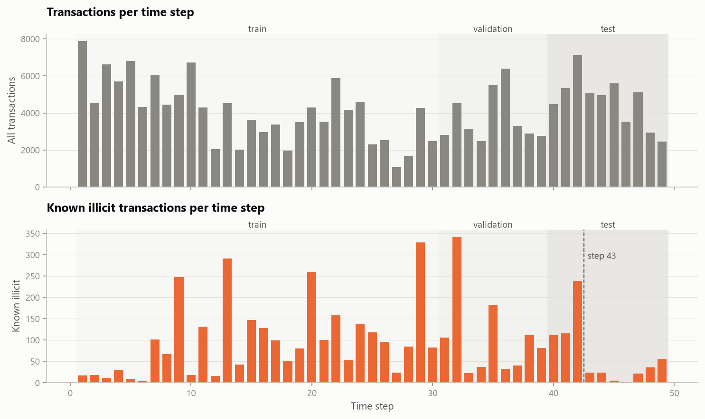
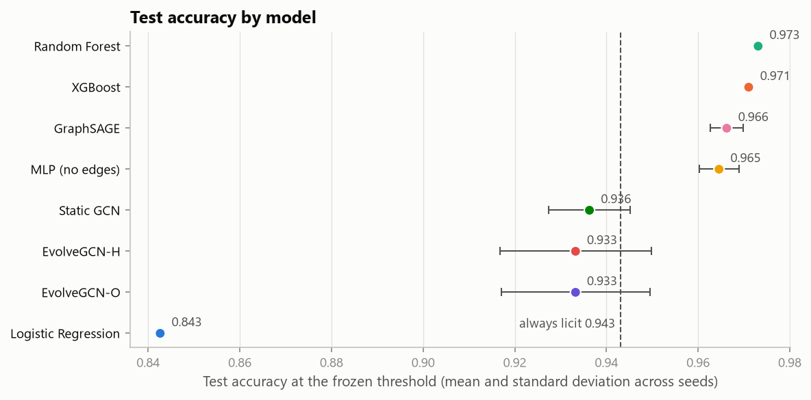
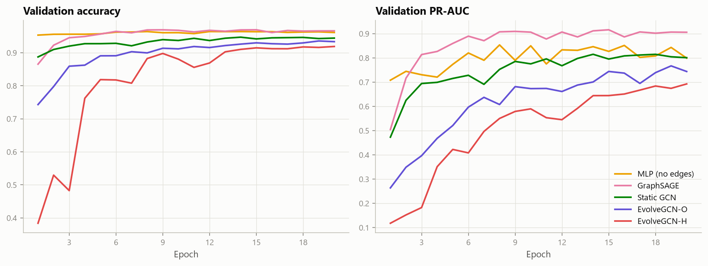
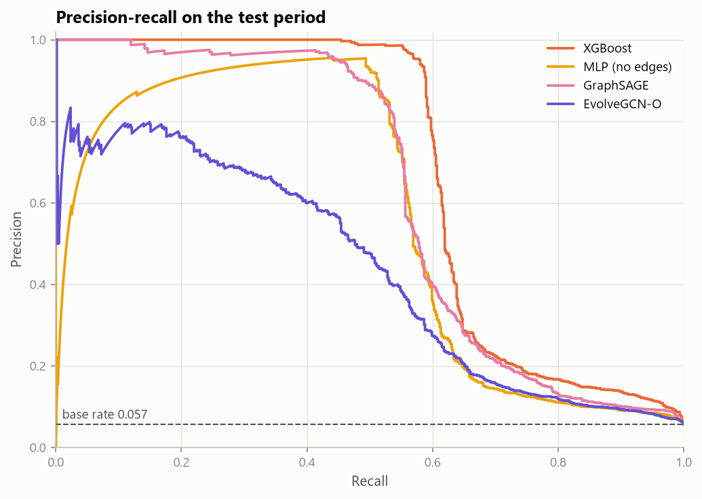
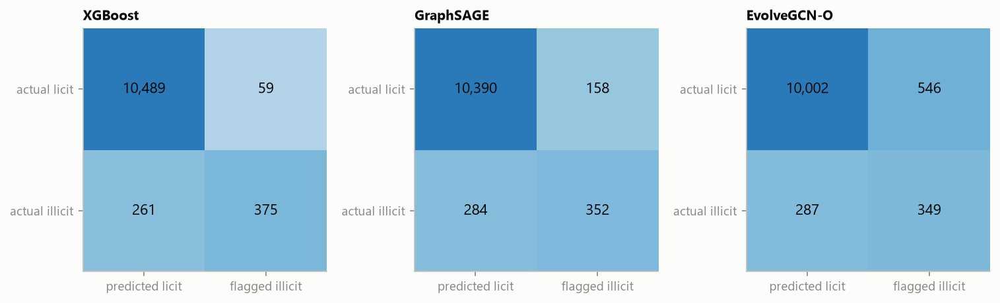
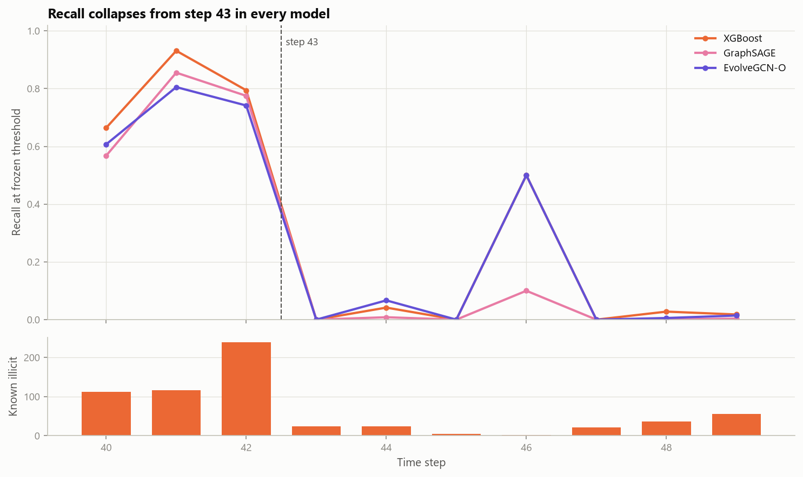
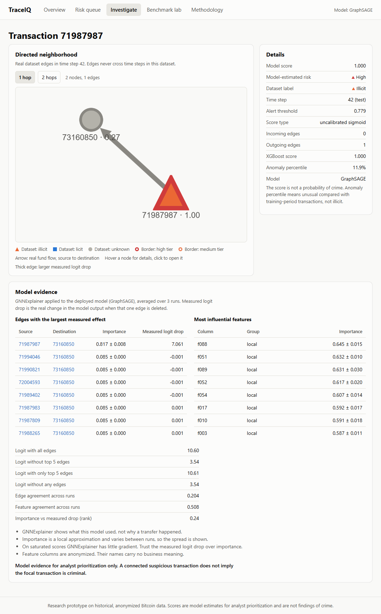

# TraceIQ: Illicit Transaction Detection with Temporal Graph Neural Networks

## Abstract

TraceIQ investigates illicit transaction classification in a directed Bitcoin transaction graph using conventional machine learning, static Graph Neural Networks and sequential graph models. We built leakage-aware chronological partitions of the Elliptic dataset and compared eight model families on one held-out test period, using illicit-class PR-AUC, precision, recall and F1. The best system was XGBoost, with a test PR-AUC of 0.675 ± 0.003 and an F1 of 0.699. With each neural model limited to 20 epochs, GraphSAGE reached 0.627 ± 0.007 and EvolveGCN-O 0.465 ± 0.072. Edges improved a neural model, but temporal state did not improve a GCN within that budget, and no graph approach beat tree ensembles. Every model failed after time step 43, where test PR-AUC of the strongest models fell from about 0.87 to about 0.05. We also found that GNNExplainer importance agreed only weakly with measured edge effects. A local dashboard supports transaction ranking and inspection of graph evidence.

## 1. Introduction

Fraud detection systems often score each transaction on its own, which can miss relationships between transactions. Graph models can use those relationships, and temporal models can use the order in which graphs appear. Whether either helps has to be measured, because simpler models are often competitive.

This project asks:

- **RQ1:** Do graph-based models outperform tabular baselines under the same chronological holdout?
- **RQ2:** Does sequential modeling across time steps improve out-of-time detection?
- **RQ3:** Can a readable interface show the subgraph and feature evidence behind a flagged prediction?

**Scope.** This is illicit-transaction classification on historical Bitcoin data. It is not validated bank or card fraud detection, it does not run in real time, and it supports analyst prioritization only.

## 2. Related work

Weber et al. (2019) released the Elliptic dataset and compared tabular models with Graph Convolutional Networks. They found Random Forest highly competitive and reported that no model handled the dark market shutdown at step 43. Hamilton et al. (2017) introduced GraphSAGE, which learns by aggregating neighborhoods and generalizes to unseen nodes. Pareja et al. (2020) introduced EvolveGCN, which evolves graph convolution weights with a recurrent network and so needs no persistent node identity. Ying et al. (2019) introduced GNNExplainer, which searches for compact subgraphs and feature subsets that preserve a prediction.

## 3. Problem formulation

The data is a sequence of snapshots G_1 ... G_49. Each G_t = (V_t, E_t, X_t) is a directed graph of the transactions in step t, with a feature matrix X_t. A label y_v is 1 for illicit, 0 for licit, or unknown. A model outputs a score for every node, and the loss and metrics use known labels only. Unknown nodes may pass messages, but they never count as negatives.

## 4. Dataset and exploratory analysis

The Elliptic dataset has 203,769 transactions, 234,355 directed edges and 49 time steps about two weeks apart. Its files were verified byte for byte against the official Kaggle release (CC BY-NC-ND 4.0). Only 22.9% of nodes are labeled: 4,545 illicit and 42,019 licit. All quality checks passed, with no duplicates, no missing values, no invalid endpoints and no edges crossing steps. The graph is sparse, with a mean degree of 1.15. The full analysis is in `docs/eda_summary.md`.

Three findings shaped the experiment.

1. **Time proxies.** Five aggregated columns (f099, f100, f102, f135, f138) rise almost linearly with the time step, with eta squared between 0.63 and 0.98 on training rows. They act as a hidden time-step input, so we removed them by a predeclared rule before any model was trained.
2. **Neighbor information inside the features.** 72 columns aggregate one-hop neighbors. A tabular model given all columns is therefore not free of graph context, so we also ran every model on the 93 local columns alone.
3. **Upstream standardization.** The publishers standardized features across all 49 steps, future steps included. This cannot be undone and is disclosed as a limitation.

## 5. Methodology

**Split.** Train covers steps 1-30, validation 31-39 and test 40-49. The split was fixed from label counts before training, and it is shared by all models.

| Period | Illicit | Licit | Illicit share of known |
|---|---:|---:|---:|
| Train | 2,954 | 23,951 | 11.0% |
| Validation | 955 | 7,520 | 11.3% |
| Test | 636 | 10,548 | 5.7% |

**Preprocessing.** Scaling was fitted on the 26,905 labeled training rows and applied unchanged elsewhere, followed by a fixed clip at ±10. Time step is never an input.

**Models.**

| Family | Models |
|---|---|
| Tabular | Logistic Regression, Random Forest, XGBoost |
| No edges | MLP |
| Static graph | GraphSAGE, Static GCN |
| Temporal | EvolveGCN-O, EvolveGCN-H |

Static GCN is EvolveGCN without weight evolution, so the pair isolates temporal state. The MLP is GraphSAGE without edges, so that pair isolates the graph.

**Temporal training.** EvolveGCN processes steps in order with the recurrent state reset at the start of each epoch and detached every five snapshots. That gives 6 weight updates per epoch, against 30 for static neural models, which update once per snapshot. At validation and test steps, the state advances using features and edges only, so no held-out label reaches the model. The state is a weight matrix and carries no transaction identity. No customer or account is followed between steps.

**Implementation.** EvolveGCN is our own implementation, because the temporal library was not needed. It differs from the paper in three ways: a linear input projection, Leaky ReLU, and truncated backpropagation through time. Leaky ReLU was required. With plain ReLU, the weight columns converged during rollout and units died, which produced constant predictions.

**Loss and threshold.** Weighted binary cross-entropy with the weight taken from training labels. The alert threshold maximizes validation F1 and is frozen per run. Scores are uncalibrated.

## 6. Experimental design

- **Selection.** Tree baselines used a grid search per feature set. Neural models used a grid search on the directed `all` variant at seed 0, and those settings were reused across variants. The variant reported for each family has the highest mean validation PR-AUC.
- **Training budget.** Every neural run trains for exactly 20 epochs with no early stopping, and keeps the weights from its best validation PR-AUC epoch. The grid search also ran at 20 epochs. Tree and linear models do not train in epochs and are unchanged.
- **Repeats.** Five seeds, except Logistic Regression, whose solver is deterministic.
- **Single test use.** Selections were written to `frozen_selection.json` before test labels were read. Training code computes no test metrics.
- **Uncertainty.** Seed mean and standard deviation, plus a paired bootstrap (1,000 rounds) over test transactions for key differences.
- **Leakage checks.** With shuffled training labels, validation PR-AUC fell to 0.09-0.13, around the 0.113 base rate. The best single column reached only 0.50.

## 7. Results and discussion

### 7.1 Main comparison

Test period: 11,184 known transactions, 636 illicit.

| Model | Features | Edges | Accuracy | Precision | Recall | F1 | PR-AUC | Recall@100 | Alerts |
|---|---|---|---:|---:|---:|---:|---:|---:|---:|
| XGBoost | all | none | 0.971 | 0.855 | 0.592 | 0.699 | 0.675 ± 0.003 | 0.157 | 440 |
| Random Forest | all | none | 0.973 | 0.922 | 0.576 | 0.709 | 0.661 ± 0.001 | 0.157 | 397 |
| GraphSAGE | local | symmetrized | 0.966 | 0.801 | 0.548 | 0.649 | 0.627 ± 0.007 | 0.153 | 439 |
| MLP | local | none | 0.965 | 0.779 | 0.543 | 0.636 | 0.566 ± 0.011 | 0.139 | 451 |
| Static GCN | local | symmetrized | 0.936 | 0.456 | 0.547 | 0.496 | 0.511 ± 0.054 | 0.142 | 772 |
| EvolveGCN-O | local | symmetrized | 0.933 | 0.461 | 0.538 | 0.486 | 0.465 ± 0.072 | 0.130 | 795 |
| EvolveGCN-H | all | symmetrized | 0.933 | 0.449 | 0.458 | 0.446 | 0.459 ± 0.068 | 0.139 | 694 |
| Logistic Regression | all | none | 0.843 | 0.203 | 0.604 | 0.304 | 0.266 ± 0.000 | 0.058 | 1,892 |

With 636 illicit test transactions, Recall@100 cannot exceed 0.157. XGBoost and Random Forest reach that ceiling, so all of their top 100 alerts are truly illicit.

Accuracy needs care on this data. Only 5.7% of known test transactions are illicit, so always guessing licit scores 0.943 while catching nothing. Static GCN, both EvolveGCN models and Logistic Regression have mean accuracy below that level, because their alert thresholds trade extra false alarms for catching illicit transactions. Logistic Regression has the highest recall and the lowest accuracy. PR-AUC and F1 remain the primary measures.

### 7.2 RQ1: do graphs help?

Only in part. Paired differences in test PR-AUC:

| Comparison | Difference | 95% interval |
|---|---:|---:|
| GraphSAGE minus XGBoost | -0.048 | -0.066 to -0.033 |
| GraphSAGE minus Random Forest | -0.034 | -0.050 to -0.019 |
| GraphSAGE minus MLP (adding edges) | +0.061 | +0.034 to +0.083 |

Adding edges clearly helps a neural model, but tree ensembles remain ahead. This also holds on local columns alone, where neither tree model sees neighbor information: XGBoost 0.656, Random Forest 0.652, GraphSAGE 0.627. Tree ensembles appear to extract more from these tabular features than our graph models gain from edges.

### 7.3 RQ2: does temporal state help?

Not within 20 epochs. Both EvolveGCN models trail Static GCN and GraphSAGE.

| Comparison | Difference | 95% interval |
|---|---:|---:|
| EvolveGCN-O minus Static GCN | -0.046 | -0.058 to -0.033 |
| EvolveGCN-H minus Static GCN | -0.052 | -0.076 to -0.028 |
| EvolveGCN-O minus GraphSAGE | -0.162 | -0.187 to -0.136 |
| EvolveGCN-H minus GraphSAGE | -0.168 | -0.193 to -0.141 |

This should be read as a result about the training budget, not as evidence against temporal state. With up to 150 epochs and early stopping, EvolveGCN-O led Static GCN by 0.050 (section 7.9). Seeds also varied widely (standard deviation 0.054 to 0.072 across these three models), and the bootstrap captures test sampling uncertainty, not seed variation. Note that the selected EvolveGCN-H variant uses all features, while the other two use local features.

### 7.4 The step 43 collapse

Every model failed after step 43.

| Model | PR-AUC, steps 40-42 | PR-AUC, steps 43-49 | F1, steps 40-42 | F1, steps 43-49 |
|---|---:|---:|---:|---:|
| XGBoost | 0.878 | 0.048 | 0.860 | 0.038 |
| Random Forest | 0.877 | 0.038 | 0.867 | 0.023 |
| GraphSAGE | 0.856 | 0.033 | 0.824 | 0.004 |
| EvolveGCN-O | 0.751 | 0.038 | 0.709 | 0.015 |
| EvolveGCN-H | 0.680 | 0.051 | 0.628 | 0.030 |

Temporal state gave no protection here. This matches Weber et al., who link the period to a dark market shutdown. It also shows that a validation PR-AUC of 0.98 is no guarantee: most of the gap to 0.675 comes from this period. Steps 43-49 hold only 169 illicit transactions, so these figures are noisy.

### 7.5 Ablations

| Question | Variant A | Variant B | Finding |
|---|---|---|---|
| Time proxies, XGBoost | Removed: 0.675 | Kept: 0.673 | No measurable effect. Removal is justified by principle, not by a gain. |
| Edge direction, GraphSAGE (local) | Directed: 0.594 | Symmetrized: 0.627 | Symmetrized is better. |
| Edge direction, EvolveGCN-O (local) | Directed: 0.290 | Symmetrized: 0.465 | Symmetrized is far better. |
| Feature set, GraphSAGE (symmetrized) | Local: 0.627 | All: 0.582 | Aggregates do not help once edges exist. |
| Feature set, XGBoost | Local: 0.656 | All: 0.675 | Aggregates help trees. |

Symmetrizing lets information flow in both directions during learning. It does not mean money moved both ways, and the dashboard always shows true direction.

### 7.6 Error analysis (GraphSAGE)

| Outcome | Count | Share after step 42 | Share with a known illicit neighbor |
|---|---:|---:|---:|
| True positive | 352 | 0.9% | 19.3% |
| False positive | 158 | 72.2% | 2.5% |
| False negative | 284 | 58.5% | 32.4% |
| True negative | 10,390 | 61.6% | 1.3% |

True positives come almost entirely from before step 43. Most false positives come after it. False negatives often have a known illicit neighbor, which suggests that model scores did not fully use that context. These are graph statistics only. Anonymized data cannot reveal why a transfer happened.

### 7.7 Anomaly detection

Isolation Forest scored a test PR-AUC of 0.034, below the 0.057 base rate. In this data, illicit transactions are not statistically unusual, so it stays a separate overlay and never enters the risk score.

### 7.8 RQ3: explanation quality

Yes, a readable interface is possible, but GNNExplainer needs caution. We explained 70 held-out transactions with the deployed model, and we measured the effect of deleting each edge.

| Measure | Result |
|---|---:|
| Rank agreement between importance and measured effect (median) | 0.30 |
| Top-5 edge agreement across three runs | 0.45 |
| Top-5 feature agreement across three runs | 0.45 |
| Mean logit drop when all edges are removed | 3.71 |

GNNExplainer was only moderately stable between runs, with less than half of its top-5 sets overlapping on average, and it agreed only weakly with real edge effects. High-scoring predictions saturate, which leaves it little gradient to learn from. The dashboard therefore ranks edges by measured logit drop and shows explainer importance beside it. Our GCN-family explainer path was also tested to equal the deployed models exactly, because GNNExplainer cannot reach layers outside PyTorch Geometric's message passing.

### 7.9 Effect of the 20-epoch budget

Test PR-AUC under the earlier configuration (up to 150 epochs, stopping after 25 epochs without improvement) and the current one. Best epochs are the range across the five seeds of the selected variant.

| Model | Up to 150 epochs | 20 epochs | Best epoch, up to 150 | Best epoch, 20 |
|---|---:|---:|---:|---:|
| GraphSAGE | 0.620 ± 0.019 | 0.627 ± 0.007 | 14-37 | 10-15 |
| MLP | 0.556 ± 0.033 | 0.566 ± 0.011 | 4-28 | 5-14 |
| Static GCN | 0.499 ± 0.061 | 0.511 ± 0.054 | 29-38 | 13-17 |
| EvolveGCN-O | 0.549 ± 0.015 | 0.465 ± 0.072 | 30-120 | 15-20 |
| EvolveGCN-H | 0.519 ± 0.036 | 0.459 ± 0.068 | 38-76 | 8-20 |

The MLP and GraphSAGE peak within the budget and lose nothing. Their small gains are within seed variation. Both EvolveGCN models lose ground and need far more than 20 epochs, because they make 6 weight updates per epoch against 30 for static models, so an equal epoch count is not equal training. Epoch-by-epoch comparisons are valid for what each model reaches in 20 passes over the data, not for each model's full potential.

## 8. System design

Training, scoring and explanation run offline and produce frozen artifacts. A read-only FastAPI service reads a SQLite index of those artifacts, and a React and Cytoscape.js dashboard shows them. It never retrains and cannot produce a score that is not stored.

The serving model is GraphSAGE, the best graph model on validation, because the interface must show graph evidence. XGBoost scored higher, and the dashboard shows its score alongside as a comparison.

The investigator moves from the overview to a ranked queue, then to one transaction's real directed neighborhood, its score, its dataset label and its model evidence. The benchmark page shows the measured results, including where the models failed.

All neural models fit comfortably on the 8 GB GPU, peaking at 302 MB. Training the 90 final neural runs took about 6 minutes, and scoring every node takes about 0.1 seconds or less for neural models.

**Testing.** 81 automated tests cover data, graph, split, models, metrics, API and acceptance, and all pass. The acceptance tests compare API output with source artifacts. A browser check confirmed that table scores equal detail scores and that no edge is invented.

## 9. Threats to validity

- The data is historical and covers Bitcoin only.
- Labels are incomplete, and unknown transactions are not random negatives.
- Features are partly anonymized and were standardized across all steps by the publishers.
- There are no edges between time steps.
- Results depend on the split, and the test period contains an unusual event.
- Neural settings were searched on one variant only and reused, so the graph variants may be under-tuned compared with the baselines.
- A fixed 20-epoch budget under-trains the temporal models compared with the static ones (section 7.9).
- The GPU runs are not bit-reproducible. In the earlier 150-epoch configuration, retraining the deployed run with the same seed gave validation PR-AUC 0.9341 against 0.9339, but individual scores differed, so benchmark means reproduce and individual transaction scores do not.
- Scores are uncalibrated.
- A benchmark result does not show real-world or regulatory suitability.

## 10. Conclusion

On this dataset and split, tree ensembles were the strongest detectors. Graph structure added real signal for neural models but did not beat XGBoost. Temporal state did not help within 20 epochs, although it did with a longer training budget, so that comparison depends on how much training each model receives. No model survived the shift at step 43, which is the most important practical finding: performance on stable periods says little about behavior after a market change. Explanations can be presented honestly, but only when checked against measured effects.

**Future work,** kept separate from the findings above: Elliptic++ with real actor links, drift detection or retraining around abrupt shifts, tuning each graph variant separately, calibrated scores.

## References

1. Weber, M. et al. (2019). Anti-Money Laundering in Bitcoin: Experimenting with Graph Convolutional Networks for Financial Forensics. https://arxiv.org/abs/1908.02591
2. Pareja, A. et al. (2020). EvolveGCN: Evolving Graph Convolutional Networks for Dynamic Graphs. https://arxiv.org/abs/1902.10191
3. Hamilton, W., Ying, R. and Leskovec, J. (2017). Inductive Representation Learning on Large Graphs. https://arxiv.org/abs/1706.02216
4. Ying, R. et al. (2019). GNNExplainer: Generating Explanations for Graph Neural Networks. https://arxiv.org/abs/1903.03894
5. Elliptic dataset. https://www.kaggle.com/ellipticco/elliptic-data-set
